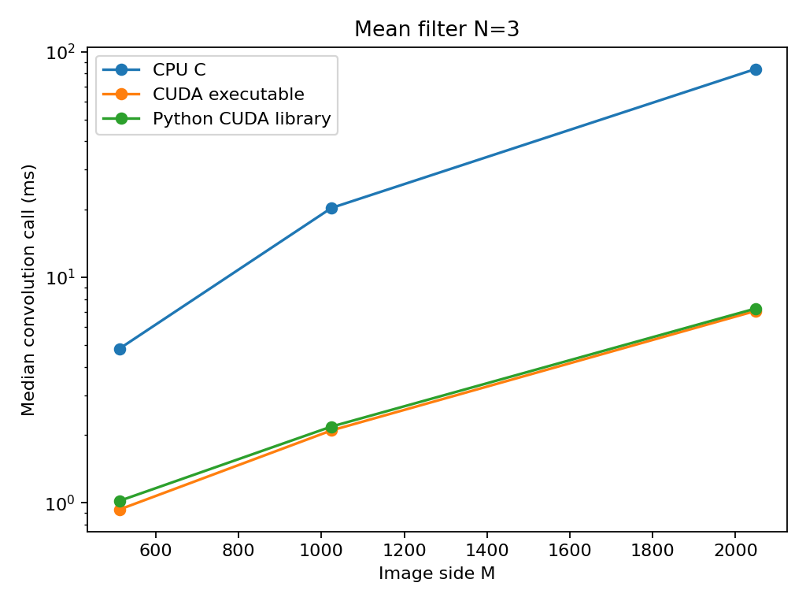
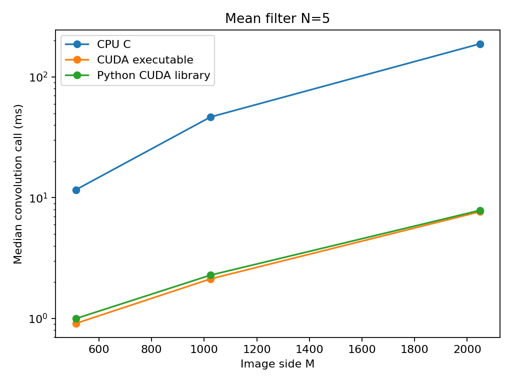
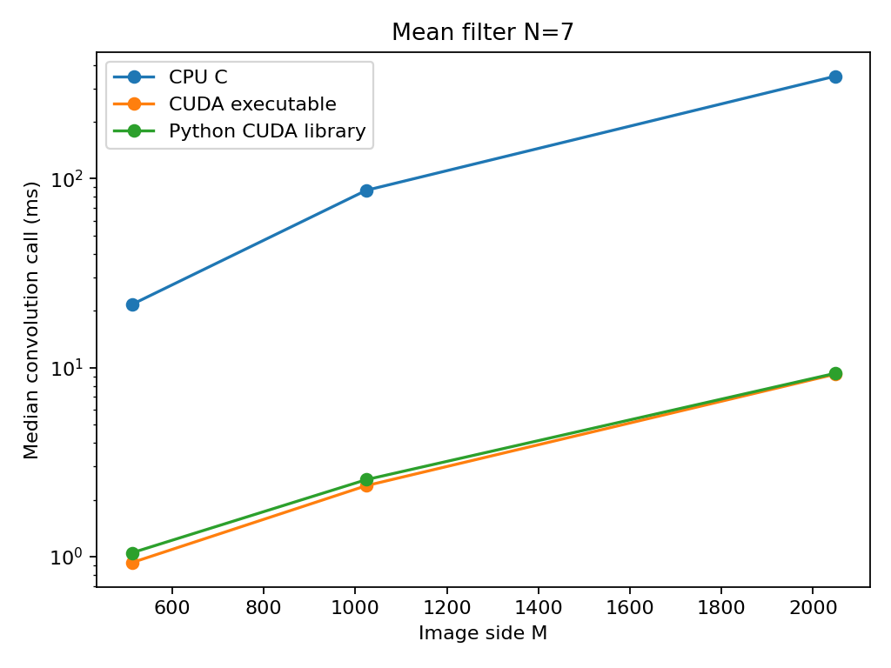

# EE542 Lab 6 — Implementation and Results Report

## Scope

This report documents the completed implementation, correctness checks, and local measurements contributed to Laboratory #6, *High-Performance CUDA Programming on Google Cloud*. It consolidates existing results; it does not claim that new experiments were executed when this report was written.

Parts 1–4 and the Part 7 matrix-library functionality are complete. Part 5 comparison data and figures exist. Part 6 implementations and measurements exist and are consolidated below. Parts 8.1-8.3 now include CPU and CUDA convolution, a Python shared-library interface, verified outputs, and performance comparisons across three image sizes and three mean-filter sizes. Their measured results and processing previews are included below.

## 1. Environment and measurement conventions

| Item | Recorded setup |
|---|---|
| CPU | Intel Core i7-14700F |
| GPU | NVIDIA GeForce RTX 5070 |
| Execution environment | Local WSL/Linux; CPU log reports a Microsoft hypervisor |
| CPU matrix implementation | Single-threaded C triple loop |
| Matrix element type | float32 |
| Matrix initialization | Fixed random seed, 42 |
| CPU timer | C `clock()`, reporting process CPU time |
| GPU timer | CUDA events around the GPU computation |
| Summary statistic | Median of three runs, except the paired cuBLASLt comparison, which uses seven runs |

Sources: [CPU environment](results/cpu_environment.txt), [CUDA check](results/cuda_check.txt), and the implementation files linked below. This setup describes the earlier matrix experiments. Part 8 results were collected separately on the Alibaba Cloud GPU server; its timing conventions are specified in Sections 9-11, and the matrix hardware entries are not attributed to that run.

The saved result logs do not establish the exact compiler versions, CUDA Toolkit version, or historical build flags. These should not be inferred from the timing values.

GPU matrix timings exclude host allocation, device allocation, host/device transfers, CPU reference verification, and file I/O. Warm-up is excluded from the timed matrix runs. Ratios against CPU time therefore describe the measured computation stages, **not end-to-end application speedup**. This CPU baseline is not an optimized CPU BLAS implementation.

## 2. Part 1: Matrix Multiplication on the CPU

Source: [matrix/matrix_cpu.c](matrix/matrix_cpu.c)  
Evidence: [results/cpu_runs.txt](results/cpu_runs.txt)

Implemented square matrix multiplication using three nested loops. A known 2 × 2 test checks that multiplying the example matrices produces `[19, 22; 43, 50]`. Each recorded execution passed this check. The larger runs also print a checksum; a checksum alone is not an independent correctness proof.

Three measurements were collected for each of five sizes:

| N | Run 1 (ms) | Run 2 (ms) | Run 3 (ms) | Median (ms) |
|---:|---:|---:|---:|---:|
| 128 | 0.758 | 0.742 | 0.738 | 0.742 |
| 256 | 6.982 | 6.994 | 6.992 | 6.992 |
| 512 | 56.219 | 60.509 | 57.760 | 57.760 |
| 1024 | 2239.783 | 2067.839 | 2097.345 | 2097.345 |
| 2048 | 46232.317 | 38574.760 | 39378.989 | 39378.989 |

The original log reports seconds; this table converts them to milliseconds.


## 3. Part 2: Introduction to CUDA Programming

Source: [matrix/matrix_gpu.cu](matrix/matrix_gpu.cu)  
Evidence: [results/gpu_naive_runs.txt](results/gpu_naive_runs.txt)

Each GPU thread computes one output element. A 16 × 16 thread block covers an output tile, and bounds checks protect threads outside the matrix.

After warm-up, the program records three kernel timings and checks every output element against a CPU reference. The check rejects non-finite output and uses the tolerance:

`absolute_error <= 1e-4 + 1e-4 * abs(reference)`

| N | Median kernel time (ms) | Maximum absolute error | Verification |
|---:|---:|---:|---|
| 128 | 0.009312 | 0.0000076293945 | PASSED; 0 mismatches |
| 256 | 0.028768 | 0.000015258789 | PASSED; 0 mismatches |
| 512 | 0.140000 | 0.000030517578 | PASSED; 0 mismatches |
| 1024 | 1.002496 | 0.000076293945 | PASSED; 0 mismatches |
| 2048 | 7.982496 | 0.00015258789 | PASSED; 0 mismatches |


## 4. Part 3: Running CUDA on a Cloud instance

The lab permits using a local NVIDIA GPU and recommends running a cloud example once CUDA works. This work used the permitted local GPU route; no cloud deployment is claimed.

Source: [environment/cuda_check.cu](environment/cuda_check.cu)  
Evidence: [results/cuda_check.txt](results/cuda_check.txt)

The environment test allocates GPU memory, uploads four integers, adds ten using a CUDA kernel, downloads the result, and checks the values:

```text
GPU: NVIDIA GeForce RTX 5070
Result: 11 12 13 14
CUDA test PASSED
```

The matrix runs in Part 2 further demonstrate successful local CUDA execution at multiple sizes.


## 5. Part 4: Optimizing CUDA Code

Source: [matrix/matrix_gpu_tiled.cu](matrix/matrix_gpu_tiled.cu)

Implemented shared-memory tiling with `TILE_WIDTH = 16`. Threads cooperatively load A and B tiles, synchronize before using them, accumulate partial products, and synchronize before the next load. Out-of-range input elements are filled with zero.

| N | Median kernel time (ms) | Maximum absolute error | Verification | Log |
|---:|---:|---:|---|---|
| 512 | 0.107648 | 0.000030517578 | PASSED; 0 mismatches | [512](results/part4_tiled_512.txt) |
| 1024 | 0.800352 | 0.000076293945 | PASSED; 0 mismatches | [1024](results/part4_tiled_1024.txt) |
| 2048 | 6.003136 | 0.00015258789 | PASSED; 0 mismatches | [2048](results/part4_tiled_2048.txt) |

Each median comes from three timed runs after warm-up.


## 6. Part 5: Performance Comparison

Data: [results/part5_comparison.csv](results/part5_comparison.csv)  
Plotting source: [matrix/plot_part5.py](matrix/plot_part5.py)

| N | CPU (ms) | Naive CUDA (ms) | Tiled CUDA (ms) | CPU / Naive | CPU / Tiled | Naive / Tiled |
|---:|---:|---:|---:|---:|---:|---:|
| 512 | 57.760 | 0.140000 | 0.107648 | 412.57× | 536.56× | 1.301× |
| 1024 | 2097.345 | 1.002496 | 0.800352 | 2092.12× | 2620.53× | 1.253× |
| 2048 | 39378.989 | 7.982496 | 6.003136 | 4933.17× | 6559.74× | 1.330× |

These are ratios for this particular single-threaded CPU implementation and GPU computation-only measurements. They do not measure the advantage over optimized CPU libraries.


Tiling improves measured GPU computation time by about 1.25–1.33×. Reducing repeated global-memory reads is the intended mechanism; no profiler measurements were collected to attribute the improvement quantitatively.

Allocation, transfers, launch overhead, and initialization can reduce the benefit at application level. Host/device data residency and repeated use of the same allocations affect that trade-off. The current logs do not separately measure transfer cost or establish an end-to-end crossover size.


## 7. Part 6: Continued Improvements

### 7.1 cuBLAS

Source: [matrix/matrix_cublas.cu](matrix/matrix_cublas.cu)

Implemented `cublasSgemm` with `CUBLAS_DEFAULT_MATH`, alpha = 1, and beta = 0. The operand order accommodates the row-major host matrices using cuBLAS's column-major convention.

| N | Median GPU time (ms) | Maximum absolute error | Verification | Log |
|---:|---:|---:|---|---|
| 512 | 0.031584 | 0.00019836426 | PASSED; 0 mismatches | [512](results/part6_cublas_512.txt) |
| 1024 | 0.166016 | 0.00064086914 | PASSED; 0 mismatches | [1024](results/part6_cublas_1024.txt) |
| 2048 | 0.721280 | 0.0018310547 | PASSED; 0 mismatches | [2048](results/part6_cublas_2048.txt) |

The verification uses absolute and relative tolerance, so maximum absolute error alone is not the pass/fail criterion.

### 7.2 Register reuse

Source: [matrix/matrix_gpu_register.cu](matrix/matrix_gpu_register.cu)

The register version uses a 16 × 16 thread block and four output accumulators per thread. Each thread computes four rows of one output column, reusing a B value across those accumulators. Each block covers up to 64 × 16 output elements.

| N | Median kernel time (ms) | Maximum absolute error | Verification | Log |
|---:|---:|---:|---|---|
| 65 | 0.019104 | 0.0000038146973 | PASSED; 0 mismatches | [65](results/part6_register_65.txt) |
| 512 | 0.057120 | 0.000030517578 | PASSED; 0 mismatches | [512](results/part6_register_512.txt) |
| 1024 | 0.378304 | 0.000076293945 | PASSED; 0 mismatches | [1024](results/part6_register_1024.txt) |
| 2048 | 2.843296 | 0.00015258789 | PASSED; 0 mismatches | [2048](results/part6_register_2048.txt) |

The N = 65 test exercises a size not divisible by the tile dimensions. Relative to tiled CUDA, the register version is approximately 1.88×, 2.12×, and 2.11× faster at N = 512, 1024, and 2048. It still takes longer than cuBLAS at these sizes.

### 7.3 cuBLASLt algorithm tuning

Source: [matrix/matrix_cublaslt_tuned.cu](matrix/matrix_cublaslt_tuned.cu)

The tuning experiment compares cuBLAS SGEMM in DEFAULT math mode with cuBLASLt using `CUBLAS_COMPUTE_32F`. It searches candidate algorithms under a 32 MiB workspace limit, then records seven paired baseline/tuned runs.

| N | Paired cuBLAS baseline (ms) | Tuned cuBLASLt (ms) | Baseline / Tuned | Search wall time (ms) | Selected workspace (bytes) | Log |
|---:|---:|---:|---:|---:|---:|---|
| 512 | 0.032608 | 0.030432 | 1.0715× | 20.049 | 128 | [512](results/part6_cublaslt_512.txt) |
| 1024 | 0.119328 | 0.112960 | 1.0564× | 8.972 | 128 | [1024](results/part6_cublaslt_1024.txt) |
| 2048 | 0.749472 | 0.749280 | 1.0003× | 41.544 | 512 | [2048](results/part6_cublaslt_2048.txt) |

Both outputs passed CPU verification with zero mismatches at every size. The recorded maximum errors match the corresponding cuBLAS values in Section 7.1.

Use the **paired baseline in this table** to evaluate tuning gains, rather than the separately collected cuBLAS measurements in Section 7.1. Search time is excluded from the tuned GPU execution time. The small median gains at 512 and 1024 do not establish statistical significance; at 2048, the result is effectively tied. This work does not demonstrate that tuning always beats every previous version.

### 7.4 Consolidated matrix timings

All entries are milliseconds. CPU and the first four GPU implementations below use medians of three runs; cuBLASLt uses seven. The table collects separate experiments and is not a single interleaved benchmark of all methods.

| Implementation | N = 512 | N = 1024 | N = 2048 |
|---|---:|---:|---:|
| CPU C | 57.760 | 2097.345 | 39378.989 |
| Naive CUDA | 0.140000 | 1.002496 | 7.982496 |
| Tiled CUDA | 0.107648 | 0.800352 | 6.003136 |
| Register CUDA | 0.057120 | 0.378304 | 2.843296 |
| cuBLAS, standalone experiment | 0.031584 | 0.166016 | 0.721280 |
| Tuned cuBLASLt, paired experiment | 0.030432 | 0.112960 | 0.749280 |

### 7.5 Observations corresponding to the Analysis Questions

1. **How does performance change as matrix size increases?** All implementations take longer as N increases. Naive and tiled GPU time grows roughly eightfold from 1024 to 2048, consistent with the cubic operation count. CPU time increases more steeply in these measurements; cache and memory-access effects are plausible contributors, but were not profiled.
2. **At what point does the GPU significantly outperform the CPU?** For computation-only timing, naive CUDA is already faster at the smallest measured size, N = 128: 0.009312 ms versus 0.742 ms. These measurements do not locate the exact crossover or establish an end-to-end threshold.
3. **How much speedup is gained by tiling optimization vs. naive CUDA?** Approximately 1.301×, 1.253×, and 1.330× for 512, 1024, and 2048.
4. **How close is your optimized kernel to cuBLAS performance?** The tiled kernel takes about 3.41×, 4.82×, and 8.32× the standalone cuBLAS time. Register reuse narrows that ratio to about 1.81×, 2.28×, and 3.94×.
5. **Why might cuBLAS still outperform hand-written kernels?** Hardware-specific algorithm selection and more sophisticated blocking, data reuse, and scheduling are plausible explanations. The current logs do not identify the internal cuBLAS kernel or prove which hardware features were used.


## 8. Part 7: Creating a Shared Library and Using it in Python

Sources: [shared_library/matrix_lib.cu](shared_library/matrix_lib.cu), [shared_library/test_matrix_lib.py](shared_library/test_matrix_lib.py)  
Evidence: [results/part7_basic_test.txt](results/part7_basic_test.txt)

The shared library wraps the tiled matrix kernel in a C-compatible interface:

- `gpu_matrix_multiply(h_A, h_B, h_C, N)`: validates pointers and N, allocates device buffers, copies inputs, runs the kernel, copies the output back, and frees buffers. Returns a CUDA status code.
- `gpu_error_string(code)`: exposes readable CUDA error messages.
- Python `gpu_matmul(a, b)`: accepts equal-size square arrays, converts them to contiguous float32, checks dimensions, calls the library with ctypes, and returns the result.

The Python wrapper supports 1 <= N <= 4096. The basic tests use a known answer for 2 × 2 and float64 NumPy multiplication of the float32 inputs as the reference for the larger cases.

| Test | Python wrapper elapsed (ms) | Maximum absolute error | Verification |
|---|---:|---:|---|
| Known 2 × 2 | 252.979 | 0 | PASSED; 0 mismatches |
| Boundary N = 65 | 0.692 | 0.0000066010613 | PASSED; 0 mismatches |
| Basic N = 512 | 1.218 | 0.00020752547 | PASSED; 0 mismatches |

These are individual functional-test call times, not warmed-up medians. The first call may include CUDA initialization overhead; the log does not isolate that cost. The wrapper timings include more work than a CUDA-event kernel measurement and must not be compared directly as equivalent metrics.

Rebuild the library for the target environment from the repository root:

```bash
bash convolution/build_part8.sh
python3 shared_library/test_matrix_lib.py
```

These commands describe how to rebuild; they are not a record of commands executed while generating this report.

## 9. Part 8.1: CPU Convolution and Image Processing

### Implementation and inputs

The CPU implementation in [convolution/convolution_cpu.c](convolution/convolution_cpu.c) computes an N × N filter over an M × M image. It reverses both filter axes, pads out-of-image samples with zero, and produces an M × M float32 output. Input pixels are uint32. Negative values, fractions, and values above 255 are preserved in the numerical output.

The experiment uses [image/photo.jpg](image/photo.jpg), converted to grayscale and resized with center cropping by [prepare_image.py](convolution/prepare_image.py). Grayscale intensities are 0-255 and stored as uint32; this preprocessing does not preserve a source image's full 32-bit intensity range.

| M | Input used by all three implementations | Grayscale preview |
|---:|---|---|
| 512 | [input_512.u32](image/input_512.u32) | [Preview](image/input_512_gray.png) |
| 1024 | [input_1024.u32](image/input_1024.u32) | [Preview](image/input_1024_gray.png) |
| 2048 | [input_2048.u32](image/input_2048.u32) | [Preview](image/input_2048_gray.png) |

The input format is an ASCII `U32 M\n` header followed by M² little-endian uint32 pixels. Output uses `F32 M\n` followed by M² little-endian float32 values.

The mean filter assigns every coefficient 1/N² and is tested with N = 3, 5, and 7 at each image size, giving the required nine image/filter-size combinations. Two additional 3 × 3 filters demonstrate edge detection and sharpening:

```text
Edge detection        Sharpening
 0 -1  0               0 -1  0
-1  4 -1              -1  5 -1
 0 -1  0               0 -1  0
```

[convolution_main.c](convolution/convolution_main.c) constructs these filters, reads inputs, times convolution calls, and writes results. The same main is compiled with `CONVOLUTION_GPU` for the CUDA executable, preserving the input and filter-generation flow.

### Correctness and CPU performance

The original [CPU basic tests](results/cpu_basic.txt) pass identity, asymmetric-filter, and signed-output cases. The new [Part 8 tests](results/part8/basic_test.txt) also verify the GPU/Python path against known answers and CPU outputs. All 15 image-processing benchmark cases pass numerical verification in [comparison.csv](results/part8/comparison.csv).

CPU mean-filter times below are medians of seven measured calls after one warmup, in milliseconds. They exclude file I/O and host-buffer allocation.

| Filter size N | M = 512 | M = 1024 | M = 2048 |
|---:|---:|---:|---:|
| 3 | 4.820 | 20.267 | 83.678 |
| 5 | 11.643 | 46.651 | 188.273 |
| 7 | 21.597 | 86.738 | 347.871 |

At fixed N, doubling M approximately quadruples CPU time: for N = 7, times are 21.597, 86.738, and 347.871 ms. At fixed M, increasing N increases the work per pixel. These observations are consistent with the direct implementation's O(M²N²) operation count.

### Image-processing results

The following previews all use the new 512 × 512 input and N = 3. [render_output.py](convolution/render_output.py) saves the full raw array as NPY and creates a PNG by clipping values to 0-255 and rounding. Thus an edge preview displays the positive response; negative responses remain in the raw output. Numerical verification uses float arrays rather than displayed PNGs.


| Filter | CPU result | CUDA result |
|---|---|---|
| Mean |  |  |
| Edge |  |  |
| Sharpen |  |  |

Mean filtering smooths local intensity variation; the edge filter highlights local changes; sharpening adds an edge response to the original intensity. CPU and CUDA previews use the same display conversion.

All 15 cases have CPU, CUDA, and Python `.f32` results in [results/part8](results/part8). The six displayed previews also have corresponding `_raw.npy` files. For example, the CPU mean preview is derived from [image0_M512_mean_N3_cpu.f32](results/part8/image0_M512_mean_N3_cpu.f32), with its full array saved as [cpu_mean_raw.npy](results/part8/cpu_mean_raw.npy).

**Status:** CPU implementation, input images, correctness tests, nine size combinations, and image-processing examples completed.

## 10. Part 8.2: Porting Convolution to CUDA

### GPU implementation and verification

Sources: [convolution_gpu.cu](convolution/convolution_gpu.cu), [convolution_gpu.h](convolution/convolution_gpu.h).

The CUDA kernel uses 16 × 16 thread blocks. Each thread computes one output pixel, iterating over the filter in the same order as the CPU. Bounds checks implement zero padding and cover image sizes that are not multiples of the block size. This implementation uses global-memory input/filter reads; no shared-memory tiling optimization is claimed.

The host interface checks pointers and dimensions, allocates device buffers, copies the image and filter, launches the kernel, synchronizes, copies output back, and releases buffers. CUDA failures are returned as error codes. Optional CUDA events measure kernel execution separately.

[Basic-test evidence](results/part8/basic_test.txt) records successful identity, asymmetric-filter, signed-output, profiled-interface, CPU/GPU comparisons including M = 17 and 65, N = 31, and uint32-range/layout tests. The [test script](shared_library/test_convolution_lib.py) also rejects invalid Python inputs, invalid C API dimensions, and null pointers.

All 15 benchmark cases passed with finite output and the tolerance:

```text
abs(GPU - CPU) <= 1e-4 + 1e-4 * abs(CPU)
```

For both standalone CUDA and Python CUDA, the largest recorded mean-filter absolute error was 0.0001220703125. Edge and sharpen outputs had zero recorded error. Floating-point tolerance accommodates arithmetic rounding; it does not require bitwise equality.

### CPU/GPU performance comparison

Evidence: [comparison.csv](results/part8/comparison.csv), [benchmark log](results/part8/benchmark.txt), and the per-case CPU/CUDA logs in [results/part8](results/part8).

Each method performs one warmup followed by seven measured calls. CPU/CUDA call time is measured with a monotonic host clock. The CUDA call includes device allocation, host/device transfers, synchronization, cleanup, and event management. Kernel time uses CUDA events and excludes allocation and transfers. Both exclude file I/O, process startup, and initial CUDA setup covered by warmup. Speedup below divides CPU call time by CUDA **call** time.

| M | N | CPU call (ms) | CUDA call (ms) | CUDA kernel (ms) | CPU / CUDA call |
|---:|---:|---:|---:|---:|---:|
| 512 | 3 | 4.820 | 0.933 | 0.033216 | 5.16× |
| 512 | 5 | 11.643 | 0.910 | 0.038688 | 12.79× |
| 512 | 7 | 21.597 | 0.930 | 0.063488 | 23.21× |
| 1024 | 3 | 20.267 | 2.092 | 0.073952 | 9.69× |
| 1024 | 5 | 46.651 | 2.127 | 0.103584 | 21.93× |
| 1024 | 7 | 86.738 | 2.375 | 0.276192 | 36.53× |
| 2048 | 3 | 83.678 | 7.082 | 0.380928 | 11.82× |
| 2048 | 5 | 188.273 | 7.659 | 0.687616 | 24.58× |
| 2048 | 7 | 347.871 | 9.224 | 1.806816 | 37.72× |

### Scaling and accelerator overhead

The CUDA call is faster than CPU C for every measured case. Mean-filter call speedup ranges from 5.16× to 37.72×. Larger filters increase CPU work substantially, while GPU allocation and transfer costs still account for much of the full call at these sizes.

For M = 2048 and N = 7, the CUDA kernel takes 1.806816 ms, while the complete CUDA call takes 9.223544 ms. Kernel execution is about 19.6% of the full-call median. The remaining cost is consistent with allocation, transfers, synchronization, cleanup, and event management; the logs do not isolate each component. Since these are separately computed medians, their difference is an indication of overhead rather than an exact component measurement.

At M = 512 and N = 3, kernel time is only 0.033216 ms versus a 0.933475 ms call, showing why kernel-only speedup would overstate the benefit for a host-array application. Reusing device buffers or keeping data on the GPU could reduce overhead, but those alternatives were not measured here.

**Status:** CUDA implementation, CPU/GPU correctness comparison, and performance collection for the same Part 8.1 inputs completed.

## 11. Part 8.3: CUDA Convolution in the Python Shared Library

### Shared-library interface and Python use

The [build script](convolution/build_part8.sh) links `shared_library/matrix_lib.cu` and `convolution/convolution_gpu.cu` into `shared_library/libmatrix.so`. It retains the existing matrix-multiplication interface and adds:

| Exported function | Purpose |
|---|---|
| `gpu_convolution(image, filter, output, M, N)` | Synchronous convolution using host arrays; returns a CUDA error code |
| `gpu_convolution_timed(image, filter, output, M, N, kernel_ms)` | Same operation with optional kernel-event timing |
| `gpu_error_string(code)` | Existing interface for readable CUDA errors |

[convolution_lib.py](shared_library/convolution_lib.py) loads the library with `ctypes.CDLL`, declares argument/return types, validates dimensions and pixel values, converts arrays to contiguous uint32/float32 storage, allocates output, and raises an exception for CUDA errors. The Python API returns an M × M float32 array. It supports 1 <= M <= 8192 and odd 1 <= N <= min(M, 31).

[benchmark_part8.py](convolution/benchmark_part8.py) uses this interface to accelerate the same image-processing operations as the CPU C and standalone CUDA programs. [test_convolution_lib.py](shared_library/test_convolution_lib.py) supplies correctness and invalid-input checks.

### Three-way performance comparison

All values below are median call times in milliseconds, using the same images and coefficients as Parts 8.1 and 8.2. Both GPU paths enable event profiling. Python call timing includes wrapper validation, any layout conversion, output allocation, ctypes dispatch, and the full synchronous CUDA call. C/CUDA host input/output buffers are allocated before timing. File I/O, imports, library loading, and process launch are excluded, so these measurements compare warmed convolution calls rather than entire application runtimes.

| M | Filter | N | CPU C (ms) | CUDA executable (ms) | Python CUDA (ms) | CPU / Python |
|---:|---|---:|---:|---:|---:|---:|
| 512 | mean | 3 | 4.820 | 0.933 | 1.019 | 4.73× |
| 512 | mean | 5 | 11.643 | 0.910 | 0.998 | 11.67× |
| 512 | mean | 7 | 21.597 | 0.930 | 1.048 | 20.60× |
| 512 | edge | 3 | 4.806 | 0.896 | 0.998 | 4.82× |
| 512 | sharpen | 3 | 4.859 | 0.881 | 0.984 | 4.94× |
| 1024 | mean | 3 | 20.267 | 2.092 | 2.176 | 9.31× |
| 1024 | mean | 5 | 46.651 | 2.127 | 2.285 | 20.42× |
| 1024 | mean | 7 | 86.738 | 2.375 | 2.555 | 33.95× |
| 1024 | edge | 3 | 19.293 | 2.260 | 2.357 | 8.18× |
| 1024 | sharpen | 3 | 19.942 | 2.264 | 2.374 | 8.40× |
| 2048 | mean | 3 | 83.678 | 7.082 | 7.258 | 11.53× |
| 2048 | mean | 5 | 188.273 | 7.659 | 7.859 | 23.96× |
| 2048 | mean | 7 | 347.871 | 9.224 | 9.324 | 37.31× |
| 2048 | edge | 3 | 78.798 | 7.324 | 7.453 | 10.57× |
| 2048 | sharpen | 3 | 77.067 | 7.262 | 7.525 | 10.24× |







Python CUDA outperforms CPU C in every measured case. At M = 2048 and N = 7, it takes 9.323787 ms versus 347.871122 ms for CPU C, giving 37.31× call speedup. Its median is about 0.100 ms, or 1.1%, above standalone CUDA. That difference includes wrapper work and run-to-run variation; it is not an isolated ctypes measurement. Python kernel timing for this case is 1.809408 ms, close to standalone CUDA's 1.806816 ms.

The measured benefit therefore comes from GPU computation while Python provides a convenient interface. Full-call performance remains constrained by the host-array interface's allocation and transfer costs. The logs contain seven-call medians without uncertainty estimates or a recorded GPU model/compiler-version snapshot, so these results describe the collected server run rather than a universal speedup guarantee.

### Reproduction

From the project root on a Linux GPU server with GCC, CUDA Toolkit, and Python dependencies `numpy`, `pillow`, and `matplotlib`:

```bash
bash convolution/build_part8.sh
mkdir -p results/part8
set -o pipefail
python3 shared_library/test_convolution_lib.py | tee results/part8/basic_test.txt
python3 convolution/benchmark_part8.py \
  --inputs image/input_512.u32 image/input_1024.u32 image/input_2048.u32 \
  --filter-sizes 3 5 7 --repeats 7 --plot \
  | tee results/part8/benchmark.txt

for backend in cpu cuda; do
  for filter in mean edge sharpen; do
    python3 convolution/render_output.py \
      "results/part8/image0_M512_${filter}_N3_${backend}.f32" \
      "results/part8/${backend}_${filter}" --mode clip
  done
done
```

The committed inputs can be regenerated from `image/photo.jpg` with `prepare_image.py --size 512`, `--size 1024`, and `--size 2048`. CSV paths record the server location `/home/ecs-user/ee542lab6/`; commands above use repository-relative paths.

**Status:** shared-library integration, Python image-processing use, correctness validation, and three-way performance comparison completed. The experimental results and figures for Parts 8.1-8.3 are included above; video-log recording/submission is a separate deliverable.
