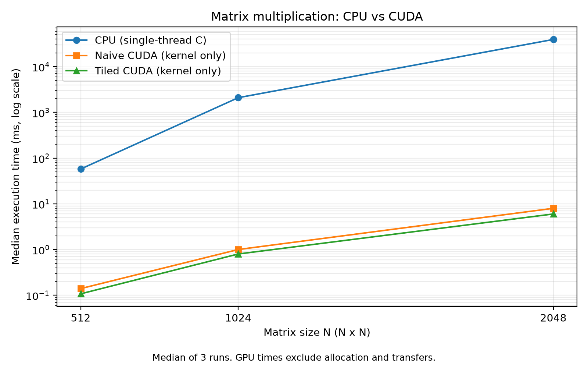
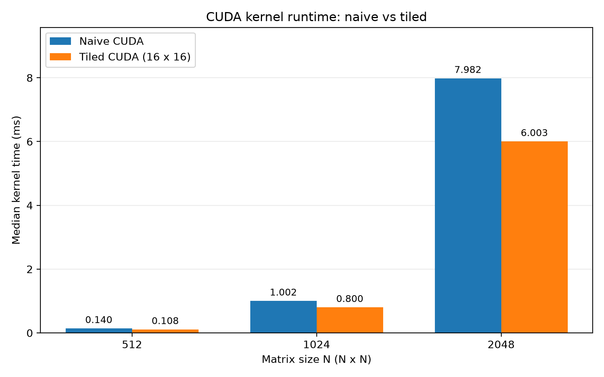

# EE542 Lab 6 — Implementation and Results Report

## Scope

This report documents the completed implementation, correctness checks, and local measurements contributed to Laboratory #6, *High-Performance CUDA Programming on Google Cloud*. It consolidates existing results; it does not claim that new experiments were executed when this report was written.

Parts 1–4 and the Part 7 matrix-library functionality are complete. Part 5 comparison data and figures exist. Part 6 implementations and measurements exist and are consolidated below. Part 8 currently includes the CPU convolution and image-processing pipeline; its multi-size performance experiments, CUDA port, and Python convolution interface remain for the team.

## 1. Environment and measurement conventions

| Item | Recorded setup |
|---|---|
| CPU | Intel Core i7-14700F |
| GPU | NVIDIA GeForce RTX 5070 |
| Execution environment | Local WSL/Linux; CPU log reports a Microsoft hypervisor |
| CPU matrix implementation | Single-threaded C triple loop |
| Matrix element type | float32 |
| Matrix initialization | Fixed random seed, 42 |
| CPU timer | C `clock()`, reporting process CPU time |
| GPU timer | CUDA events around the GPU computation |
| Summary statistic | Median of three runs, except the paired cuBLASLt comparison, which uses seven runs |

Sources: [CPU environment](results/cpu_environment.txt), [CUDA check](results/cuda_check.txt), and the implementation files linked below.

The saved result logs do not establish the exact compiler versions, CUDA Toolkit version, or historical build flags. These should not be inferred from the timing values.

GPU matrix timings exclude host allocation, device allocation, host/device transfers, CPU reference verification, and file I/O. Warm-up is excluded from the timed matrix runs. Ratios against CPU time therefore describe the measured computation stages, **not end-to-end application speedup**. This CPU baseline is not an optimized CPU BLAS implementation.

## 2. Part 1: Matrix Multiplication on the CPU

Source: [matrix/matrix_cpu.c](matrix/matrix_cpu.c)  
Evidence: [results/cpu_runs.txt](results/cpu_runs.txt)

Implemented square matrix multiplication using three nested loops. A known 2 × 2 test checks that multiplying the example matrices produces `[19, 22; 43, 50]`. Each recorded execution passed this check. The larger runs also print a checksum; a checksum alone is not an independent correctness proof.

Three measurements were collected for each of five sizes:

| N | Run 1 (ms) | Run 2 (ms) | Run 3 (ms) | Median (ms) |
|---:|---:|---:|---:|---:|
| 128 | 0.758 | 0.742 | 0.738 | 0.742 |
| 256 | 6.982 | 6.994 | 6.992 | 6.992 |
| 512 | 56.219 | 60.509 | 57.760 | 57.760 |
| 1024 | 2239.783 | 2067.839 | 2097.345 | 2097.345 |
| 2048 | 46232.317 | 38574.760 | 39378.989 | 39378.989 |

The original log reports seconds; this table converts them to milliseconds.

**Status:** implementation, basic correctness validation, and multi-size repeated measurements completed.

## 3. Part 2: Introduction to CUDA Programming

Source: [matrix/matrix_gpu.cu](matrix/matrix_gpu.cu)  
Evidence: [results/gpu_naive_runs.txt](results/gpu_naive_runs.txt)

Each GPU thread computes one output element. A 16 × 16 thread block covers an output tile, and bounds checks protect threads outside the matrix.

After warm-up, the program records three kernel timings and checks every output element against a CPU reference. The check rejects non-finite output and uses the tolerance:

`absolute_error <= 1e-4 + 1e-4 * abs(reference)`

| N | Median kernel time (ms) | Maximum absolute error | Verification |
|---:|---:|---:|---|
| 128 | 0.009312 | 0.0000076293945 | PASSED; 0 mismatches |
| 256 | 0.028768 | 0.000015258789 | PASSED; 0 mismatches |
| 512 | 0.140000 | 0.000030517578 | PASSED; 0 mismatches |
| 1024 | 1.002496 | 0.000076293945 | PASSED; 0 mismatches |
| 2048 | 7.982496 | 0.00015258789 | PASSED; 0 mismatches |

**Status:** implementation, full-output checks for the recorded sizes, and multi-size measurements completed.

## 4. Part 3: Running CUDA on a Cloud instance

The lab permits using a local NVIDIA GPU and recommends running a cloud example once CUDA works. This work used the permitted local GPU route; no cloud deployment is claimed.

Source: [environment/cuda_check.cu](environment/cuda_check.cu)  
Evidence: [results/cuda_check.txt](results/cuda_check.txt)

The environment test allocates GPU memory, uploads four integers, adds ten using a CUDA kernel, downloads the result, and checks the values:

```text
GPU: NVIDIA GeForce RTX 5070
Result: 11 12 13 14
CUDA test PASSED
```

The matrix runs in Part 2 further demonstrate successful local CUDA execution at multiple sizes.

**Status:** local GPU alternative completed. Cloud execution was not performed in the recorded work.

## 5. Part 4: Optimizing CUDA Code

Source: [matrix/matrix_gpu_tiled.cu](matrix/matrix_gpu_tiled.cu)

Implemented shared-memory tiling with `TILE_WIDTH = 16`. Threads cooperatively load A and B tiles, synchronize before using them, accumulate partial products, and synchronize before the next load. Out-of-range input elements are filled with zero.

| N | Median kernel time (ms) | Maximum absolute error | Verification | Log |
|---:|---:|---:|---|---|
| 512 | 0.107648 | 0.000030517578 | PASSED; 0 mismatches | [512](results/part4_tiled_512.txt) |
| 1024 | 0.800352 | 0.000076293945 | PASSED; 0 mismatches | [1024](results/part4_tiled_1024.txt) |
| 2048 | 6.003136 | 0.00015258789 | PASSED; 0 mismatches | [2048](results/part4_tiled_2048.txt) |

Each median comes from three timed runs after warm-up.

**Status:** shared-memory implementation and all three specified sizes completed.

## 6. Part 5: Performance Comparison

Data: [results/part5_comparison.csv](results/part5_comparison.csv)  
Plotting source: [matrix/plot_part5.py](matrix/plot_part5.py)

| N | CPU (ms) | Naive CUDA (ms) | Tiled CUDA (ms) | CPU / Naive | CPU / Tiled | Naive / Tiled |
|---:|---:|---:|---:|---:|---:|---:|
| 512 | 57.760 | 0.140000 | 0.107648 | 412.57× | 536.56× | 1.301× |
| 1024 | 2097.345 | 1.002496 | 0.800352 | 2092.12× | 2620.53× | 1.253× |
| 2048 | 39378.989 | 7.982496 | 6.003136 | 4933.17× | 6559.74× | 1.330× |

These are ratios for this particular single-threaded CPU implementation and GPU computation-only measurements. They do not measure the advantage over optimized CPU libraries.





Tiling improves measured GPU computation time by about 1.25–1.33×. Reducing repeated global-memory reads is the intended mechanism; no profiler measurements were collected to attribute the improvement quantitatively.

Allocation, transfers, launch overhead, and initialization can reduce the benefit at application level. Host/device data residency and repeated use of the same allocations affect that trade-off. The current logs do not separately measure transfer cost or establish an end-to-end crossover size.

**Status:** comparison CSV, speedup calculations, and figures completed. The discussion above records the timing limitations.

## 7. Part 6: Continued Improvements

### 7.1 cuBLAS

Source: [matrix/matrix_cublas.cu](matrix/matrix_cublas.cu)

Implemented `cublasSgemm` with `CUBLAS_DEFAULT_MATH`, alpha = 1, and beta = 0. The operand order accommodates the row-major host matrices using cuBLAS's column-major convention.

| N | Median GPU time (ms) | Maximum absolute error | Verification | Log |
|---:|---:|---:|---|---|
| 512 | 0.031584 | 0.00019836426 | PASSED; 0 mismatches | [512](results/part6_cublas_512.txt) |
| 1024 | 0.166016 | 0.00064086914 | PASSED; 0 mismatches | [1024](results/part6_cublas_1024.txt) |
| 2048 | 0.721280 | 0.0018310547 | PASSED; 0 mismatches | [2048](results/part6_cublas_2048.txt) |

The verification uses absolute and relative tolerance, so maximum absolute error alone is not the pass/fail criterion.

### 7.2 Register reuse

Source: [matrix/matrix_gpu_register.cu](matrix/matrix_gpu_register.cu)

The register version uses a 16 × 16 thread block and four output accumulators per thread. Each thread computes four rows of one output column, reusing a B value across those accumulators. Each block covers up to 64 × 16 output elements.

| N | Median kernel time (ms) | Maximum absolute error | Verification | Log |
|---:|---:|---:|---|---|
| 65 | 0.019104 | 0.0000038146973 | PASSED; 0 mismatches | [65](results/part6_register_65.txt) |
| 512 | 0.057120 | 0.000030517578 | PASSED; 0 mismatches | [512](results/part6_register_512.txt) |
| 1024 | 0.378304 | 0.000076293945 | PASSED; 0 mismatches | [1024](results/part6_register_1024.txt) |
| 2048 | 2.843296 | 0.00015258789 | PASSED; 0 mismatches | [2048](results/part6_register_2048.txt) |

The N = 65 test exercises a size not divisible by the tile dimensions. Relative to tiled CUDA, the register version is approximately 1.88×, 2.12×, and 2.11× faster at N = 512, 1024, and 2048. It still takes longer than cuBLAS at these sizes.

### 7.3 cuBLASLt algorithm tuning

Source: [matrix/matrix_cublaslt_tuned.cu](matrix/matrix_cublaslt_tuned.cu)

The tuning experiment compares cuBLAS SGEMM in DEFAULT math mode with cuBLASLt using `CUBLAS_COMPUTE_32F`. It searches candidate algorithms under a 32 MiB workspace limit, then records seven paired baseline/tuned runs.

| N | Paired cuBLAS baseline (ms) | Tuned cuBLASLt (ms) | Baseline / Tuned | Search wall time (ms) | Selected workspace (bytes) | Log |
|---:|---:|---:|---:|---:|---:|---|
| 512 | 0.032608 | 0.030432 | 1.0715× | 20.049 | 128 | [512](results/part6_cublaslt_512.txt) |
| 1024 | 0.119328 | 0.112960 | 1.0564× | 8.972 | 128 | [1024](results/part6_cublaslt_1024.txt) |
| 2048 | 0.749472 | 0.749280 | 1.0003× | 41.544 | 512 | [2048](results/part6_cublaslt_2048.txt) |

Both outputs passed CPU verification with zero mismatches at every size. The recorded maximum errors match the corresponding cuBLAS values in Section 7.1.

Use the **paired baseline in this table** to evaluate tuning gains, rather than the separately collected cuBLAS measurements in Section 7.1. Search time is excluded from the tuned GPU execution time. The small median gains at 512 and 1024 do not establish statistical significance; at 2048, the result is effectively tied. This work does not demonstrate that tuning always beats every previous version.

### 7.4 Consolidated matrix timings

All entries are milliseconds. CPU and the first four GPU implementations below use medians of three runs; cuBLASLt uses seven. The table collects separate experiments and is not a single interleaved benchmark of all methods.

| Implementation | N = 512 | N = 1024 | N = 2048 |
|---|---:|---:|---:|
| CPU C | 57.760 | 2097.345 | 39378.989 |
| Naive CUDA | 0.140000 | 1.002496 | 7.982496 |
| Tiled CUDA | 0.107648 | 0.800352 | 6.003136 |
| Register CUDA | 0.057120 | 0.378304 | 2.843296 |
| cuBLAS, standalone experiment | 0.031584 | 0.166016 | 0.721280 |
| Tuned cuBLASLt, paired experiment | 0.030432 | 0.112960 | 0.749280 |

### 7.5 Observations corresponding to the Analysis Questions

1. **How does performance change as matrix size increases?** All implementations take longer as N increases. Naive and tiled GPU time grows roughly eightfold from 1024 to 2048, consistent with the cubic operation count. CPU time increases more steeply in these measurements; cache and memory-access effects are plausible contributors, but were not profiled.
2. **At what point does the GPU significantly outperform the CPU?** For computation-only timing, naive CUDA is already faster at the smallest measured size, N = 128: 0.009312 ms versus 0.742 ms. These measurements do not locate the exact crossover or establish an end-to-end threshold.
3. **How much speedup is gained by tiling optimization vs. naive CUDA?** Approximately 1.301×, 1.253×, and 1.330× for 512, 1024, and 2048.
4. **How close is your optimized kernel to cuBLAS performance?** The tiled kernel takes about 3.41×, 4.82×, and 8.32× the standalone cuBLAS time. Register reuse narrows that ratio to about 1.81×, 2.28×, and 3.94×.
5. **Why might cuBLAS still outperform hand-written kernels?** Hardware-specific algorithm selection and more sophisticated blocking, data reuse, and scheduling are plausible explanations. The current logs do not identify the internal cuBLAS kernel or prove which hardware features were used.

The remaining presentation work is to extend the existing plots to all measured implementations, document the optimization research sources, and explain the trade-offs in the video log.

## 8. Part 7: Creating a Shared Library and Using it in Python

Sources: [shared_library/matrix_lib.cu](shared_library/matrix_lib.cu), [shared_library/test_matrix_lib.py](shared_library/test_matrix_lib.py)  
Evidence: [results/part7_basic_test.txt](results/part7_basic_test.txt)

The shared library wraps the tiled matrix kernel in a C-compatible interface:

- `gpu_matrix_multiply(h_A, h_B, h_C, N)`: validates pointers and N, allocates device buffers, copies inputs, runs the kernel, copies the output back, and frees buffers. Returns a CUDA status code.
- `gpu_error_string(code)`: exposes readable CUDA error messages.
- Python `gpu_matmul(a, b)`: accepts equal-size square arrays, converts them to contiguous float32, checks dimensions, calls the library with ctypes, and returns the result.

The Python wrapper supports 1 <= N <= 4096. The basic tests use a known answer for 2 × 2 and float64 NumPy multiplication of the float32 inputs as the reference for the larger cases.

| Test | Python wrapper elapsed (ms) | Maximum absolute error | Verification |
|---|---:|---:|---|
| Known 2 × 2 | 252.979 | 0 | PASSED; 0 mismatches |
| Boundary N = 65 | 0.692 | 0.0000066010613 | PASSED; 0 mismatches |
| Basic N = 512 | 1.218 | 0.00020752547 | PASSED; 0 mismatches |

These are individual functional-test call times, not warmed-up medians. The first call may include CUDA initialization overhead; the log does not isolate that cost. The wrapper timings include more work than a CUDA-event kernel measurement and must not be compared directly as equivalent metrics.

Rebuild the library for the target environment from the repository root:

```bash
nvcc -Xcompiler -fPIC -shared shared_library/matrix_lib.cu -o shared_library/libmatrix.so
python3 shared_library/test_matrix_lib.py
```

These commands describe how to rebuild; they are not a record of commands executed while generating this report.

**Status:** shared-library implementation, Python interface, and basic correctness validation completed.

## 9. Part 8.1: Convolution Function — completed CPU work

### Implementation and file responsibilities

| File | Responsibility |
|---|---|
| [convolution.h](convolution/convolution.h) | CPU convolution interface |
| [convolution_cpu.c](convolution/convolution_cpu.c) | Convolution calculation with filter reversal and zero padding |
| [convolution_main.c](convolution/convolution_main.c) | Input parsing, filter construction, CPU invocation, and output writing |
| [test_convolution_cpu.c](convolution/test_convolution_cpu.c) | Known-answer correctness tests |
| [prepare_image.py](convolution/prepare_image.py) | Image orientation correction, grayscale conversion, optional square crop/resize, and uint32 export |
| [render_output.py](convolution/render_output.py) | Float output validation, raw NPY saving, and PNG preview generation |

Images use unsigned 32-bit pixel storage. The current preprocessing converts images to 8-bit grayscale intensities before storing them as uint32; it does not claim to preserve a source image's full 32-bit intensity range.

The input format is an ASCII `U32 M\n` header followed by M × M little-endian uint32 values. Output uses `F32 M\n` followed by little-endian float32 values. Raw output preserves negative values, fractions, and values above 255. Clipping or absolute-value conversion is only for visualization.

The command-line program supports odd mean-filter sizes from 1 to 31, subject to N <= M. Edge and sharpen filters use N = 3.

### Basic correctness

Evidence: [results/cpu_basic.txt](results/cpu_basic.txt)

| Test | Purpose | Result |
|---|---|---|
| Identity | Preserve the input with a center coefficient of one | PASSED; 0 mismatches |
| Asymmetric convolution | Check filter reversal and zero-padded boundaries | PASSED; 0 mismatches |
| Signed edge response | Preserve negative convolution values | PASSED; 0 mismatches |

Evidence: [results/image_io_basic.txt](results/image_io_basic.txt)

The image input test used a 512 × 512 uint32 image with pixel values from 13 to 255. Saving and reloading the input produced identical pixels: `Image read/write verification: PASSED`.

The recorded input paths are `images/input_512.u32` and `images/input_512_gray.png`. These input files are not present in the repository snapshot used for this report. They or a reproducible source image and preprocessing command should be added for exact reproduction.

### Saved image-processing outputs

The repository contains the float result, raw NPY array, and PNG preview for each filter:

| Filter | Float result | Raw array | Preview |
|---|---|---|---|
| Mean | [F32](results/cpu_mean.f32) | [NPY](results/cpu_mean_raw.npy) | [PNG](results/cpu_mean.png) |
| Edge | [F32](results/cpu_edge.f32) | [NPY](results/cpu_edge_raw.npy) | [PNG](results/cpu_edge.png) |
| Sharpen | [F32](results/cpu_sharpen.f32) | [NPY](results/cpu_sharpen_raw.npy) | [PNG](results/cpu_sharpen.png) |

#### Mean-filter preview


#### Edge-filter preview


#### Sharpen-filter preview


These previews demonstrate the saved processing outputs; numerical correctness is assessed using raw values and the known-answer tests, not PNG appearance alone.

**Status:** CPU implementation, filter examples, basic correctness checks, and image I/O/output pipeline completed. No CPU convolution performance table is claimed: the current main program has no calculation timer.

## 10. Remaining team work

| Lab section | Remaining work | Reuse |
|---|---|---|
| Parts 1–4 | No missing implementation or specified measurement work identified; retain the completed local results | Existing matrix sources and logs |
| Part 5 | Incorporate the existing figures and timing-scope discussion in the final team presentation | Part 5 CSV and PNGs |
| Part 6 | Plot all implementations using the existing data; add optimization research references and video explanation | Consolidated tables above, Part 6 logs, and matrix plotting script |
| Part 7 | Include the shared-library description in the final presentation; no additional functionality is required | Existing matrix library and Python tests |
| Part 8.1 | Add CPU computation timing; collect at least three image sizes M and three filter sizes N; complete the sample-image presentation | CPU convolution and image scripts |
| Part 8.2 | Implement CUDA convolution, verify against CPU results, and compare timings on the same images and filters | CPU reference, known-answer tests, and image file formats |
| Part 8.3 | Export CUDA convolution through the shared library, call it from Python, and compare CPU C, direct CUDA, and Python-to-CUDA execution | Part 7 interface pattern and the new CUDA convolution |
| Final deliverables | Complete the team report/video with all-implementation runtime plots, scaling, overhead, optimization trade-offs, and Python library description | Existing results plus remaining Part 8 experiments |

A practical Part 8 test matrix is M = 256, 512, 1024 and mean-filter N = 3, 5, 7, covering all nine combinations. This is a proposed experiment plan, not completed data. Edge and sharpen examples remain at N = 3.

For application-level comparisons, use consistent timing boundaries and exclude image loading/saving unless explicitly reporting I/O. Separate CUDA kernel time from allocation/transfer/call time. Preserve the current local results when collecting measurements on another machine.

The existing `matrix/plot_part5.py` contains fixed Part 5 data and currently writes under `matrix/results/`. When extending it, read or insert the correct recorded data and point its output to the intended repository results directory.

